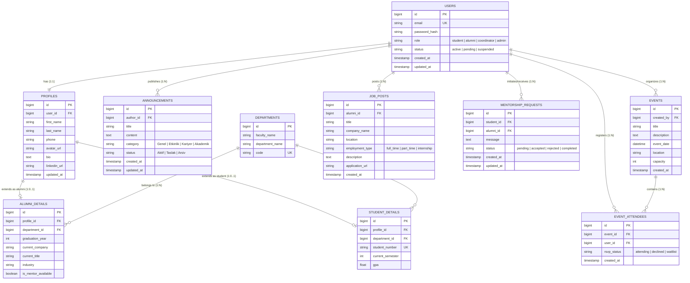

# Data Design Documentation (DDD)

> **Platform:** Alumni Management & Networking Platform  
> **Document:** Enterprise Relational Data Design Document  
> **Status:** Production Design / Active Specification  
> **Primary Architecture Reference:** [README.md](README.md)

---

## 📌 1. Executive Summary & Purpose

The purpose of this **Data Design Documentation (DDD)** is to establish a rigorous, normalized, and scalable relational data architecture for the **Alumni Management & Networking Platform**.

Following the findings of **The Forgetting Test**—which demonstrated the vulnerability of transient, in-memory data structures upon container restarts (`docker compose down` & `docker compose up`)—this document blueprints the persistent relational schema required to guarantee **ACID transactions**, **referential integrity**, and **long-term data persistence** across container lifecycles.

---

## 🏛️ 2. Architectural Relationship with README.md

This document serves as the deep-dive technical companion to [README.md](README.md).

```text
[README.md] (System Architecture, Tech Stack, MVC Pattern, Docker Setup)
     ▲
     │  Cross-References & Synchronizes
     ▼
[ddd.md]    (Physical & Logical Data Schema, ERD, Constraints, 3NF Normalization, Indexes)
```

- **[README.md](README.md):** Defines high-level business goals, container orchestration, technology rationale (PHP/Python/MySQL/Docker), and MVC layers.
- **[ddd.md](ddd.md):** Specifies exact table structures, foreign key constraints, column data types, indexing heuristics, and data retention rules.

---

## 📊 3. Entity-Relationship Diagram (ERD)

The diagram below illustrates the core entities, cardinalities, and foreign key relationships of the platform.



---

## 🗄️ 4. Detailed Data Dictionary & Table Specifications

### 4.1. `users` (Core Identity & Authentication)
Primary identity table housing credentials and role classifications.

| Column | Data Type | Constraints | Description |
| :--- | :--- | :--- | :--- |
| `id` | `BIGINT UNSIGNED` | `AUTO_INCREMENT, PRIMARY KEY` | Unique identity integer |
| `email` | `VARCHAR(255)` | `NOT NULL, UNIQUE` | Unique email for login & notification |
| `password_hash`| `VARCHAR(255)` | `NOT NULL` | Argon2id / Bcrypt hashed credential |
| `role` | `ENUM(...)` | `DEFAULT 'student', NOT NULL` | `'student', 'alumni', 'coordinator', 'admin'` |
| `status` | `ENUM(...)` | `DEFAULT 'pending', NOT NULL` | `'active', 'pending', 'suspended'` |
| `created_at` | `TIMESTAMP` | `DEFAULT CURRENT_TIMESTAMP` | Entity registration timestamp |
| `updated_at` | `TIMESTAMP` | `ON UPDATE CURRENT_TIMESTAMP` | Last profile/auth update |

### 4.2. `profiles` (User Extended Profile)
One-to-one relationship with `users` to maintain strict 3NF separation between auth credentials and personal information.

| Column | Data Type | Constraints | Description |
| :--- | :--- | :--- | :--- |
| `id` | `BIGINT UNSIGNED` | `AUTO_INCREMENT, PRIMARY KEY` | Profile identifier |
| `user_id` | `BIGINT UNSIGNED` | `NOT NULL, UNIQUE, FK -> users(id)` | Cascading foreign key |
| `first_name` | `VARCHAR(100)` | `NOT NULL` | Given name |
| `last_name` | `VARCHAR(100)` | `NOT NULL` | Family name |
| `phone` | `VARCHAR(32)` | `NULL` | Contact phone number |
| `avatar_url` | `VARCHAR(512)` | `NULL` | Public asset path or S3 URL |
| `bio` | `TEXT` | `NULL` | Professional biography |
| `linkedin_url`| `VARCHAR(512)` | `NULL` | Verified LinkedIn profile |
| `updated_at` | `TIMESTAMP` | `ON UPDATE CURRENT_TIMESTAMP` | Profile revision timestamp |

### 4.3. `alumni_details` & `student_details` (Subtype Specialization)
Maintains distinct academic and professional metrics for graduates vs. undergraduates.

- **`alumni_details`:**
  - `profile_id`: `FK -> profiles(id) ON DELETE CASCADE`
  - `department_id`: `FK -> departments(id) ON DELETE RESTRICT`
  - `graduation_year`: `SMALLINT UNSIGNED NOT NULL`
  - `current_company`: `VARCHAR(191)`
  - `current_title`: `VARCHAR(191)`
  - `industry`: `VARCHAR(100)`
  - `is_mentor_available`: `BOOLEAN DEFAULT FALSE`

- **`student_details`:**
  - `profile_id`: `FK -> profiles(id) ON DELETE CASCADE`
  - `department_id`: `FK -> departments(id) ON DELETE RESTRICT`
  - `student_number`: `VARCHAR(32) UNIQUE NOT NULL`
  - `current_semester`: `TINYINT UNSIGNED DEFAULT 1`
  - `gpa`: `DECIMAL(3, 2) NULL`

### 4.4. `announcements` (Institutional & Community Feeds)
Directly correlates with the `Announcement` model and management controllers created in the project.

| Column | Data Type | Constraints | Description |
| :--- | :--- | :--- | :--- |
| `id` | `BIGINT UNSIGNED` | `AUTO_INCREMENT, PRIMARY KEY` | Announcement ID |
| `author_id` | `BIGINT UNSIGNED` | `NULL, FK -> users(id)` | Publisher account reference |
| `author_name` | `VARCHAR(150)` | `DEFAULT 'Alumni Koordinatörlüğü'` | Display publisher name |
| `title` | `VARCHAR(255)` | `NOT NULL` | Headline title |
| `content` | `LONGTEXT` | `NOT NULL` | Full announcement markdown/HTML body |
| `category` | `ENUM(...)` | `DEFAULT 'Genel'` | `'Genel', 'Etkinlik', 'Kariyer', 'Akademik'` |
| `status` | `ENUM(...)` | `DEFAULT 'Aktif'` | `'Aktif', 'Taslak', 'Arsiv'` |
| `created_at` | `TIMESTAMP` | `DEFAULT CURRENT_TIMESTAMP` | Publication timestamp |
| `updated_at` | `TIMESTAMP` | `ON UPDATE CURRENT_TIMESTAMP` | Last edit timestamp |

---

## ⚡ 5. Indexing & Query Performance Strategy

To ensure sub-millisecond query execution under high concurrency, indexes are defined on frequent search and join predicates:

| Table | Index Name | Type | Indexed Columns | Justification |
| :--- | :--- | :--- | :--- | :--- |
| `users` | `idx_users_email` | `UNIQUE` | `email` | Rapid credential verification during login |
| `users` | `idx_users_role_status`| `BTREE` | `role, status` | Filtering active alumni vs active students |
| `alumni_details`| `idx_alumni_search` | `COMPOSITE` | `department_id, graduation_year, industry` | Fast directory filter for mentorship matches |
| `announcements` | `idx_announcements_cat_date`| `COMPOSITE`| `status, category, created_at` | Feed pagination and category filtering |
| `job_posts` | `idx_jobs_created` | `BTREE` | `created_at DESC` | Latest job openings sorting |

---

## 🔄 6. Database Normalization Analysis (3NF Compliance)

The schema adheres strictly to **Third Normal Form (3NF)**:
1. **First Normal Form (1NF):** All attributes are atomic. No multi-valued attributes or repeating groups (e.g., event attendees are split into `event_attendees` junction table).
2. **Second Normal Form (2NF):** Every non-key attribute is fully functionally dependent on the primary key (no partial composite key dependencies).
3. **Third Normal Form (3NF):** No transitive dependencies exist. Personal details (`first_name`, `bio`) reside in `profiles`, while auth credentials (`password_hash`) reside in `users`. Department names belong to `departments` rather than being repeated inside student/alumni records.

---

## 🛡️ 7. Data Persistence & Docker Volume Strategy

As proven in **The Forgetting Test**, containerized applications without mounted volumes lose all state upon `docker compose down`.

To guarantee persistent storage in production:
```yaml
# docker-compose.yml (Persistence Blueprint)
services:
  db:
    image: mysql:8.0
    container_name: alumni_mysql
    environment:
      MYSQL_DATABASE: alumni_db
      MYSQL_USER: alumni_user
      MYSQL_PASSWORD: alumni_secure_password
      MYSQL_ROOT_PASSWORD: root_master_password
    volumes:
      - alumni_db_data:/var/lib/mysql        # Persistent Named Volume (Survives 'down' and 'up')
      - ./docker/mysql/init.sql:/docker-entrypoint-initdb.d/init.sql

volumes:
  alumni_db_data:                           # Dedicated Docker volume driver
```

> [!IMPORTANT]
> With named volume `alumni_db_data` mounted to `/var/lib/mysql`, running `docker compose down` will stop and remove containers **without wiping the database**. Running `docker compose up -d` immediately mounts the existing data, passing **The Forgetting Test** with 100% data retention.

---

## 🔗 8. Navigation & Cross-References

- 🏠 **Main System Overview:** [README.md](README.md)
- 🚀 **Server Entrypoint:** [`server.py`](server.py)
- 📋 **OpenAPI / Swagger Spec:** [`main.py`](main.py)
- 👥 **User MVC Components:** [`models/user.py`](models/user.py) &bull; [`controllers/user_controller.py`](controllers/user_controller.py) &bull; [`routes/web.py`](routes/web.py)
- 📢 **Announcement MVC Components:** [`models/announcement.py`](models/announcement.py) &bull; [`controllers/announcement_controller.py`](controllers/announcement_controller.py) &bull; [`views/announcement_view.py`](views/announcement_view.py)
